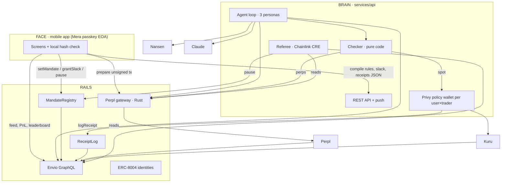

# LEASH — Architecture & Shared Contracts (team of 3)

> **Every coding agent loads this file.** Put it at the repo root and reference it from your lane's `CLAUDE.md`. If your brief conflicts with this file, this file wins. Changes to Section 7 ("Frozen interfaces") need a heads-up in team chat first.
> Lanes: **Brain** (agent + API + Referee), **Rails** (contracts + Perpl gateway + Envio), **Face** (mobile app + video).

---

## 1. Problem
People who don't think of themselves as crypto users want automated trading, but three things stop them:
1. **Custody fear.** Bots get your keys or your funds. Leaked keys mean someone else trades your money (3Commas, 2022).
2. **Black box.** Nobody can say why the bot traded.
3. **Fake track records.** Bot performance is self-reported and cherry-picked.

Monad's best venues (Perpl perps, Kuru spot order book) are built for pros. LEASH is the front door for everyone else.

## 2. Product
**Tagline:** Give your AI trader slack. Never your keys.

**Flow:** Face ID sign-in (Mera) → write rules in plain English → sign a Leash Card onchain → hire a trader persona → read receipts → grant slack or pull the leash.

### Five knots (the core architecture story)
Any single knot can stop the trader without trusting the others.

| # | Knot | Held by | Enforces |
|---|---|---|---|
| 1 | Rules | `MandateRegistry` + pure-code checker | Leverage, size, markets, rate limits, weekly loss; slack grants with expiry |
| 2 | Wallet | Privy server wallet policy | Spot sleeve can only call Kuru and transfer back to the user |
| 3 | Exchange | Perpl trade-only key | Trader can never withdraw collateral |
| 4 | Referee | Chainlink CRE workflow | Independent watchdog; pauses onchain on breach or stale data (fails closed) |
| 5 | You | Mera passkey | Kill switch; only the user can resume; approves slack |

### Creative features (all in scope unless marked stretch)
1. **Commit–reveal receipts.** Every decision (executed, denied, shadow) logs `reasonHash` + `signalHash` onchain. Full JSON served by the API. **The phone recomputes the hash and shows ✓ only on match.**
2. **Slack requests.** When the checker denies a high-confidence intent for a limit rule, the trader asks the user for a narrow, expiring exception. The user signs `grantSlack` with Face ID. The checker uses the active grant; receipts record `usedSlack`.
3. **Shadow-first traders.** Personas start in shadow mode; their calls are committed onchain (`status = SHADOW`) before outcomes, so paper records can't be edited later.
4. **Hire a trader.** Three personas on one engine, each with an ERC-8004 identity and a leaderboard computed by Envio from Perpl fills:
   - **Falcon:** momentum, follows smart money (Nansen). LIVE.
   - **Otter:** mean reversion, small size. SHADOW.
   - **Owl:** funding harvester, hedges spot on Kuru. SHADOW.
5. **Referee fails closed.** Stale gateway/indexer data for 3 consecutive checks counts as a breach.
6. **Speed you can see.** Each receipt shows decision → confirmed time (measured by Brain in ms; block timestamps are only 1s resolution).
7. **(Stretch) Gasless panic button.** `pauseWithPasskey` verifies a WebAuthn P-256 signature via precompile `0x0100`; anyone can relay.

## 3. Components and owners

| Component | Path | Tech | Owner |
|---|---|---|---|
| Contracts: `MandateRegistry`, `ReceiptLog` | `contracts/` | Solidity, Foundry ≥ 1.8 | Rails |
| Trader identities ×3 | `contracts/script/` | ERC-8004 via Agent0 SDK | Rails |
| Perpl gateway | `services/perpl-gateway/` | Rust, `perpl-sdk`, alloy, axum | Rails |
| Indexer | `indexer/` | Envio HyperIndex v3, Envio Cloud | Rails |
| Agent engine + API | `services/api/` | Node 20, TypeScript, Hono, Claude API | Brain |
| Signals, wallet, spot | `services/api/` | Nansen, Privy server wallets, Kuru, Alchemy | Brain |
| Referee | `guardian/` | Chainlink CRE (TypeScript) | Brain |
| Shared package | `packages/shared/` | zod schemas, canonical JSON, sendTx, checker | Brain (Rails owns `abis/`, `addresses.ts`) |
| Mobile app | `apps/mobile/` | Expo React Native dev build, Mera, viem | Face |

### Diagram


## 4. Key flows

**Onboarding (Face → Brain/Rails):** passkey → EOA → `POST /gas/drip` → fund AUSD → `POST /perpl/deposit/prepare` (user signs) → `POST /keys/prepare` (user authorizes the per-user trade-only key; mechanism = Q1) → `POST /devices` (Expo push token).

**Rules:** `POST /mandate/compile` → Leash Card → user signs `setMandate` (agentId = chosen persona) → `POST /agent/activate` (Brain confirms onchain, creates the Privy wallet for this user×trader with the user-locked policy).

**One tick (~30s, Brain):**
1. Read mandate + `activeSlack` (RPC latest). Stop if paused.
2. Gather: gateway `/risk`, Envio recent receipts/fills, Nansen signals.
3. Claude → `Intent` (zod). Invalid → HOLD.
4. `checkIntent(policy, slack, state, intent)` → `Decision`.
5. Allowed → (Alchemy simulate if available) → gateway `/orders/execute` or Privy → Kuru.
6. Store `ReceiptDetail` → `logReceipt` from the Privy wallet. Record `decidedAtMs`, `confirmedAtMs`.
7. Denied for `LEVERAGE_EXCEEDS` / `NOTIONAL_EXCEEDS` with confidence ≥ 0.7 → create `SlackRequest` → Expo push.

**Shadow personas (Brain):** same loop, no execution; persona wallet calls `logShadow` with `status = SHADOW`.

**Slack (Face → Rails → Brain):** push → sheet → user signs `grantSlack(...)` → `POST /slack/:id/approved {txHash}` → Brain re-checks the original intent if still fresh (≤ 2 min) and executes.

**Kill:** user signs `pause(user,"user")` → `POST /agent/kill` (stop loop, Privy deny-all, gateway `/keys/disable`). **Referee:** every minute; breach or 3× stale → `pause(user,"referee:<rule>")`. Gateway and Brain both refuse execution when `isActive(user) == false`.

## 5. Monad-specific decisions (from the docs)
1. Gas is charged on the **declared gas limit**. All txs go through `packages/shared/sendTx.ts`: estimate, +10%, explicit `gas`.
2. EIP-7702-delegated EOAs can't drop below **10 MON** (Reserve Balance). **No 7702 on user wallets**; Brain runs a gas drip. Keep MON buffers on agent, referee, gas-tank and persona wallets.
3. Full nodes don't serve old state → **all history from Envio.**
4. No global mempool → confirm by receipt only.
5. Mera: **prompt-per-transaction** in the app (users sign rarely). Passkeys bound to `rpId` → **domain chosen at kickoff, never changed.** Demo on iPhone/iCloud Keychain.
6. P-256 precompile `0x0100` → stretch passkey pause.
7. Foundry ≥ 1.8, `network = "monad"`; verify on MonadVision (Sourcify) + Monadscan.

## 6. Units (everyone)
- USD: 6-decimal ints (`usd6`) onchain/DB; decimal strings in JSON.
- Prices: decimal strings in APIs; `uint256` 1e18 onchain.
- Side: `"LONG"|"SHORT"|"BUY"|"SELL"` in TS; `int8` ±1 onchain.
- Markets: `"MON-PERP"`, `"MON/AUSD"`; onchain `bytes32 = keccak256(market)`.
- Leverage `X10` (30 = 3.0x); percentages in bps.
- **Canonical JSON:** `packages/shared/canonical.ts` (sorted keys recursively, no whitespace). Brain and Face must both import this one function; the on-device hash check depends on it.
  - `reasonHash = keccak256(utf8(canonicalJSON({ intent, decision })))`
  - `signalHash = keccak256(utf8(canonicalJSON(signalsSnapshot)))`
  - `policyHash = keccak256(utf8(canonicalJSON(policy)))`

## 7. Frozen interfaces (commit by CP0 Sun 23:00; consumers use fixtures until real ones land)

### 7.1 Solidity (Rails)
```solidity
interface IMandateRegistry {
  struct Mandate {
    bytes32 policyHash; uint64 maxNotionalUsd6; uint16 maxLeverageX10; uint16 maxWeeklyLossBps;
    uint256 agentId; address agentWallet; address perplKey; bool paused; uint64 updatedAt;
  }
  struct Slack { uint16 maxLeverageX10; uint64 maxNotionalUsd6; uint64 extraRiskUsd6; uint64 expiresAt; }

  event MandateSet(address indexed user, uint256 indexed agentId, bytes32 policyHash, uint64 maxNotionalUsd6,
                   uint16 maxLeverageX10, uint16 maxWeeklyLossBps, address agentWallet, address perplKey);
  event SlackGranted(address indexed user, uint16 maxLeverageX10, uint64 maxNotionalUsd6, uint64 extraRiskUsd6, uint64 expiresAt);
  event SlackRevoked(address indexed user);
  event Paused(address indexed user, address indexed by, string reason);
  event Resumed(address indexed user);

  function setMandate(Mandate calldata m) external;                 // msg.sender = user; unpauses; clears slack
  function grantSlack(Slack calldata s) external;                   // user only; expiresAt <= now + 24h
  function revokeSlack() external;                                  // user only
  function pause(address user, string calldata reason) external;    // user or referee; clears slack
  function resume() external;                                       // user only
  function getMandate(address user) external view returns (Mandate memory);
  function activeSlack(address user) external view returns (Slack memory s, bool active);
  function isActive(address user) external view returns (bool);
  function referee() external view returns (address);
}

interface IReceiptLog {
  enum Venue  { PERPL, KURU }
  enum Status { EXECUTED, REJECTED, FAILED, SHADOW }
  struct ReceiptInput {
    address user; Venue venue; bytes32 market; int8 side; uint128 sizeUsd6; uint256 price1e18;
    Status status; bool usedSlack; bytes32 reasonHash; bytes32 signalHash; bytes32 execTxHash;
  }
  event TradeReceipt(address indexed user, uint256 indexed agentId, uint64 indexed seq,
    Venue venue, bytes32 market, int8 side, uint128 sizeUsd6, uint256 price1e18,
    Status status, bool usedSlack, bytes32 reasonHash, bytes32 signalHash, bytes32 execTxHash);

  // only the user's registered agentWallet; EXECUTED requires isActive(user); SHADOW not allowed here
  function logReceipt(ReceiptInput calldata r) external;
  // anyone; forces user = msg.sender, status = SHADOW; Envio counts it only if msg.sender is a known persona wallet
  function logShadow(uint256 agentId, ReceiptInput calldata r) external;
}
```
(Use `via_ir = true` if you hit stack-too-deep.)

### 7.2 Shared TS schemas (`packages/shared/schemas.ts`, zod; Brain)
```ts
Policy = { version:1, markets:string[], venues:("PERPL"|"KURU")[], maxLeverage:number, maxNotionalUsd:string,
  maxTotalExposureUsd:string, maxWeeklyLossPct:number, maxTradesPerHour:number, cooldownSec:number,
  requireSmartMoneyAgreement:boolean, minConfidence:number, sleeveUsd:string }
Persona = { id:"falcon"|"otter"|"owl", agentId:string, name:string, style:string, mode:"LIVE"|"SHADOW",
  wallet:address, defaultPolicy:Policy }
Intent = { id:uuid, ts:iso, persona:Persona["id"], action:"OPEN"|"CLOSE"|"REDUCE"|"SWAP"|"HOLD",
  venue:"PERPL"|"KURU", market:string, side:Side, sizeUsd:string, leverage:number, confidence:number,
  rationale:string /* ≤500 chars */, signals:{source:"nansen"|"envio"|"perpl", key:string, value:string}[] }
Decision = { intentId:uuid, allowed:boolean, reasons:RuleCode[], usedSlack:boolean, checkedAt:iso }
RuleCode = "OK"|"PAUSED"|"MARKET_NOT_ALLOWED"|"VENUE_NOT_ALLOWED"|"LEVERAGE_EXCEEDS"|"NOTIONAL_EXCEEDS"
  |"EXPOSURE_EXCEEDS"|"WEEKLY_LOSS_LIMIT"|"RATE_LIMIT"|"COOLDOWN"|"LOW_CONFIDENCE"
  |"NO_SMART_MONEY_AGREEMENT"|"INVALID_INTENT"|"CANNOT_WITHDRAW"
SlackRequest = { id:uuid, account:address, persona:string, intentId:uuid, rule:RuleCode,
  requested:{ maxLeverage:number, maxNotionalUsd:string, extraRiskUsd:string, durationSec:number },
  why:{ text:string, source:string }[], createdAt:iso, expiresAt:iso, status:"PENDING"|"APPROVED"|"DENIED"|"EXPIRED" }
RiskSnapshot = { account, ts, equityUsd, collateralUsd, marginUsedUsd, weeklyPnlPct, fundingPaidUsd,
  slackLeftUsd, positions:{ market, side, sizeUsd, entryPrice, markPrice, liqPrice, liqDistancePct, unrealizedPnlUsd }[],
  exposureByMarket:Record<string,string> }
ReceiptDetail = { reasonHash, signalHash, intent:Intent, decision:Decision, signalsSnapshot:object,
  model:string, decidedAtMs:number, confirmedAtMs:number|null, execTxHash:string|null }
TxRequest = { to:address, data:hex, value:string, gas:string, chainId:143 }
```
Fixtures for every type in `packages/shared/fixtures/` at CP0 (include one EXECUTED, one REJECTED with slack request, one SHADOW).

### 7.3 Perpl gateway API (Rails; `GATEWAY_URL`)
| Method | Path | Returns |
|---|---|---|
| GET | `/health` | `{ ok, block, cacheLagBlocks }` |
| GET | `/markets` | `[{ market, perpId, mark, index, fundingRate, tickSize, lotSize }]` |
| GET | `/book/:market?depth=20` | `{ bids, asks, ts }` |
| GET | `/account/:address` | `{ collateralUsd, equityUsd, marginUsedUsd, positions[] }` |
| GET | `/risk/:address` | `RiskSnapshot` (weekly baseline from Envio) |
| POST | `/orders/prepare` | unsigned `TxRequest` for the user to sign |
| POST | `/orders/execute` | `{txHash,status}`; signs with that user's trade-only key; refuses if `!isActive`, stale cache, market not allowlisted, or size > `MAX_ORDER_USD` |
| POST | `/deposit/prepare` | `TxRequest[]` |
| POST | `/keys/prepare` | enrollment payload for the user (per Q1) |
| POST | `/keys/disable` | disables the user's key locally |

### 7.4 Backend API (Brain; `API_URL`)
| Method | Path | Purpose |
|---|---|---|
| POST | `/mandate/compile` | `{account,text,persona}` → `{policy, policyHash, leashCard[], warnings[]}` |
| POST | `/agent/activate` · `/agent/kill` | start after onchain mandate · stop + deny-all + disable key |
| GET | `/agent/status/:account` | `{state, persona, lastTick, lastDecision}` |
| GET | `/traders` | `Persona[]` with live stats from Envio |
| GET | `/receipts/:reasonHash` | `ReceiptDetail` |
| GET | `/slack/pending/:account` · POST `/slack/:id/approved` · POST `/slack/:id/denied` | slack flow |
| POST | `/devices` | `{account, expoPushToken}` |
| POST | `/gas/drip` | once per address |
| GET | `/config` | addresses, personas, referee, chain |
| POST | `/webhooks/alchemy` | AUSD deposit → push |

### 7.5 Envio entities (Rails)
`User`, `Mandate`, `SlackGrant`, `Agent` (id = agentId; executed/rejected/shadow counts, volumeUsd, realizedPnlUsd, shadowPnlUsd, maxDrawdownPct), `Receipt`, `PauseEvent`, `PerplFill`, `KuruTrade`, `PnlSnapshot` (agent × day). Example queries in `packages/shared/queries.graphql` + JSON fixtures at CP0.

## 8. Timeline (America/Phoenix). Confirm the exact cutoff on hackathon.monad.xyz tonight.
| When | Checkpoint | Exit criteria |
|---|---|---|
| Sun 21:00 | Kickoff | Roles confirmed, domain chosen, wallets created, open questions assigned |
| Sun 23:00 | **CP0 interfaces frozen** | §7 committed: ABIs, schemas, fixtures, OpenAPI stubs, queries |
| Mon 12:00 | **CP1 lanes standalone** | Contracts live + verified; Face ID login on phone; agent paper mode; gateway reads Perpl; indexer syncing |
| Mon 20:00 | **CP2 first real trade** | Login → rules signed → Falcon trades on Perpl → receipt onchain → app shows ✓ |
| Tue 08:00 | **CP3 feature freeze** | Slack, shadow personas, Referee, risk, traders, spot, kill switch |
| Tue | **Submit** | ≥ 2h before cutoff: video, write-up, README, repo |

## 9. Rules for every coding agent (root `CLAUDE.md`)
- Read official docs before integrating. **Never invent addresses, ABIs, endpoints.** Addresses live only in `packages/shared/addresses.ts` with a source URL; check bytecode on chain 143.
- Monad docs index: `https://docs.monad.xyz/llms.txt`.
- All txs via `sendTx.ts`. All hashing via `canonical.ts`.
- Don't change §7 silently; propose in chat, the owner updates it.
- `.env` only for secrets; commit `.env.example`; never log keys.
- TS strict; zod for every external and LLM payload.
- Small descriptive commits (judges verify the build window).
- Blocked > 45 min → stub behind the interface, note in `docs/LIMITATIONS.md`, move on.
- `LIVE=false` by default; `MAX_ORDER_USD=25` until demo.

## 10. Open questions (owner writes the answer here)
| # | Question | Owner |
|---|---|---|
| Q1 | How do Perpl trade-only API keys work; can our app sign the enrollment? | Rails |
| Q2 | Perpl collateral token (AUSD?) | Rails |
| Q3 | Kuru TS SDK, router, MON/AUSD market on 143 | Brain |
| Q4 | CRE support for Monad EVM write, or simulate only? | Brain |
| Q5 | ERC-8004 registry addresses on 143 | Rails |
| Q6 | Alchemy simulation on Monad? | Brain |
| Q7 | Nansen endpoints with Monad smart-money coverage | Brain |
| Q8 | Privy policy: restrict ERC-20 transfer recipient on 143? | Brain |
| Q9 | Exact submission cutoff + form fields | Face |

## 11. Sponsor → feature map
| Bounty | Feature | Owner |
|---|---|---|
| Agora Onchain Trading | Mobile app, Mera, AUSD balance, Perpl trades | Face + Rails |
| Perpl API | Live trader via trade-only key | Rails + Brain |
| Perpl Analytics/Risk | Risk view, leash ring, Referee math | Rails + Face |
| Kuru Consumer Trading | Spot screen + Owl's hedge sleeve | Brain + Face |
| Privy | Per user×trader policy wallets | Brain |
| Nansen | Smart-money signals + "why" chips | Brain |
| Chainlink CRE | Referee | Brain |
| Envio | Receipts, leaderboard, PnL | Rails |
| Alchemy | RPC, simulation, deposit webhooks | Brain |
| Aurora Intents (only if ahead) | Any-chain funding | Brain + Face |
