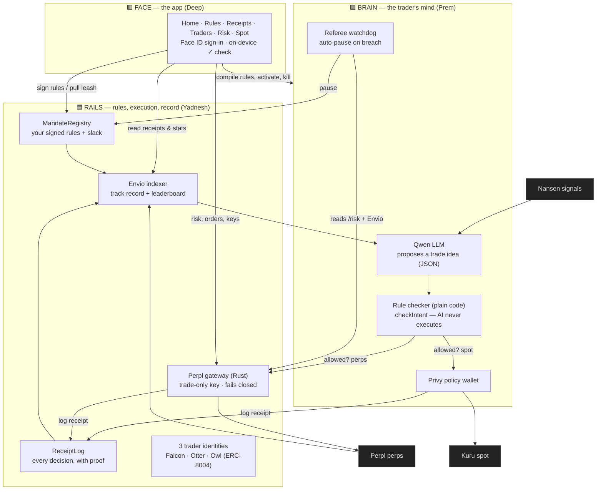
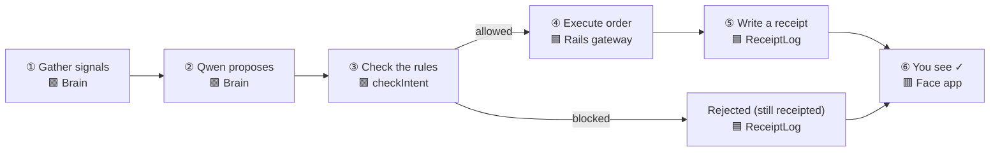

# LEASH — architecture, features & who built what

> **Give your AI trader slack. Never your keys.**
> An AI trades Perpl perps and Kuru spot on Monad. It can trade, but it can’t
> withdraw your money, can’t break your rules, and can’t hide a decision.

Team of 3 — colours below show who wrote each part:

- 🟦 **Yadnesh — RAILS**: smart contracts, Perpl gateway, Envio indexer
- 🟪 **Prem — BRAIN**: AI engine (Qwen), API, Referee watchdog
- 🟥 **Deep — FACE**: the app you see, Face ID, the demo video

A pretty, screenshot-ready version is in **`docs/architecture-diagram.html`** (open in a browser).

---

## 1. The big picture

---

## 2. How one trade flows (runs on its own, ~every 30s)

The key safety idea: **the AI only suggests; dumb, predictable code decides.**
If the AI is confused or tricked, the worst it can do is propose a bad trade —
the rule checker blocks it.

---

## 3. The five knots — any one stops the trader

| # | Knot | What it enforces | Built by |
|---|------|------------------|----------|
| 1 | **Rules** | Your signed limits: markets, size, leverage, weekly loss | 🟦 Rails · `MandateRegistry` |
| 2 | **Wallet** | Spot sleeve can only touch Kuru / repay you | 🟪 Brain · Privy |
| 3 | **Exchange key** | Place orders, **never withdraw** | 🟦 Rails · gateway |
| 4 | **Referee** | Auto-pause on big loss / risky position / stale data | 🟪 Brain · Chainlink CRE |
| 5 | **You** | “Hold to pull the leash” — stop everything with Face ID | 🟥 Face · passkey |

---

## 4. Every case the system handles

| Case | Result | What happens |
|------|--------|--------------|
| Trade passes all rules | 🟢 **EXECUTED** | Order sent to Perpl, green receipt, counts on the leaderboard |
| Trade breaks a rule | 🔴 **REJECTED** | Refused — and the refusal is receipted too, so it’s provable |
| Practice trade (Otter/Owl) | 🟣 **SHADOW** | Logged on-chain *before* the outcome → track records can’t be faked |
| Strong idea just over a limit | ✋ **Slack request** | Trader asks you for a narrow, expiring exception; you approve with Face ID |
| Loss / liquidation / stale data | 🟠 **PAUSED (referee)** | Watchdog pauses on-chain; only you can resume |
| You hit the button | 🟠 **PAUSED (you)** | Loop off, key disabled, policy denies all — instantly |
| AI confused or attacked | 🔴 **HOLD** | Unparseable output → treated as HOLD, receipted as rejected; AI never executes |
| Spot swap on Kuru | 🟢 swap | AUSD↔MON, user-signed (Owl’s hedge / your spot screen) |

---

## 5. Simple analogy (non-technical)

You **hire a robot trader** and give it a strict rulebook you sign with your
fingerprint. You give it a key that can **place trades but never take money
out** — like letting a broker buy and sell for you, but never withdraw cash.
It trades on its own; every idea is checked against your rules, and every
decision (done *or* refused) prints a **receipt you can’t fake**. Three
independent safeguards plus a big **“pull the leash”** button can stop it at
any second.

---

*Live on Monad testnet: contracts verified, Perpl gateway on Render, Envio
indexer, and a web app with browser Face ID.*
